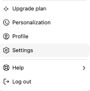
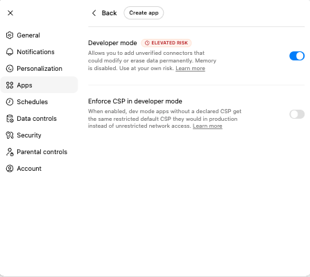
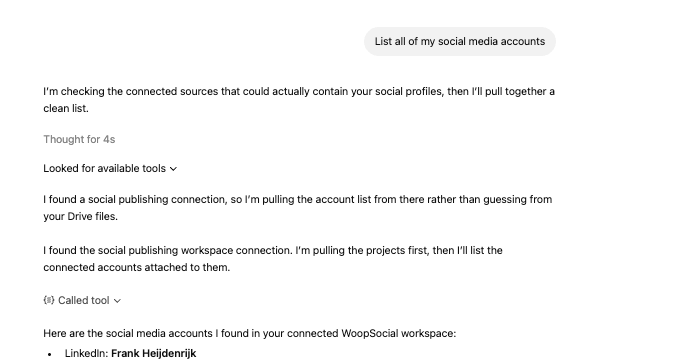
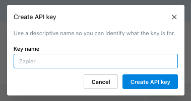
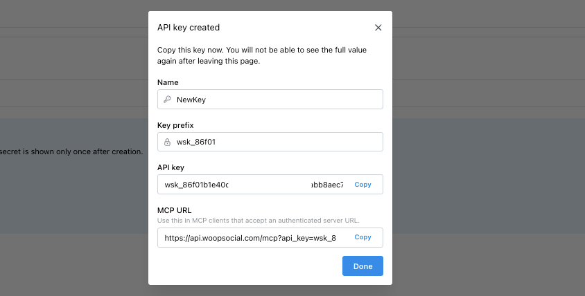

Use this page to connect the WoopSocial MCP server to your AI agent, Claude, ChatGPT or your CLI.

## Prerequisites

- A WoopSocial account
- A connected social media account on WoopSocial
- Access to the AI Agent/AI Chat/CLI you want to configure

## Select your AI tool or Agent

- [Claude (web, Desktop, Cowork)](#claude-cowork)
- [Claude Code](#claude-code)
- [Codex](#codex)
- [ChatGPT](#chatgpt)
- [Notion](#notion)
- [Gemini CLI](#gemini-cli)
- [Cursor](#cursor)
- [Other AI agents](#ai-agents)

## Claude (web, Desktop, Cowork) {#claude-cowork}

WoopSocial is listed in Claude's Connectors Directory as a Community connector. You don't need an API key or an MCP URL.

1. Open the [WoopSocial connector](https://claude.ai/directory/woopsocial) in Claude's Connectors Directory and add it to Claude. If you aren't signed in to Claude, you'll be asked to sign in first.
2. Read the notice Claude shows for Community connectors, then continue
3. Sign in to WoopSocial, or create a free account, and click **Authorize**
4. Make sure you have at least one social media account connected ([Connect accounts in your dashboard](https://app.woopsocial.com))
5. **Start a new Chat** in Claude. If WoopSocial isn't turned on, click **+** → **Connectors** and toggle it on
6. Ask Claude to write a test post to your social account for tomorrow
7. It will find your **Project ID** and **Social Account ID** and will schedule a test post for tomorrow
8. If you want, you can delete the post straight away

The connector belongs to your Claude account, so you only add it once.

**Can't use the directory?** Add WoopSocial as a custom connector instead. Go to **Customize** → **Connectors** → **+ Add** → **Add custom connector**, name it `woopsocial`, use `https://api.woopsocial.com/mcp` as the URL and follow the prompts. On Team and Enterprise plans, an owner adds connectors in **Organization settings** → **Connectors**.

**Note:** Text posts work in any chat. To upload images and videos from a chat, Claude needs code execution turned on and access to `*.r2.cloudflarestorage.com` (including the asterisk/star), where your media is stored. You can set both in **Settings** → **Capabilities**, in the code execution network settings.

Issues? Just use the chat button in the bottom right and we’ll help you out.

## Claude Code CLI {#claude-code}

If you added the [Claude connector](#claude-cowork) and sign in to Claude Code with the same Claude account, WoopSocial is already available. Type `/mcp` in Claude Code to check.

Otherwise, use the `claude mcp add` command to register WoopSocial with Claude Code.

```bash
claude mcp add --transport http woopsocial "https://api.woopsocial.com/mcp"
```

1. Ensure that you have a [WoopSocial account](https://app.woopsocial.com) and you are logged in
2. Connect a social media account [through your WoopSocial dashboard](https://app.woopsocial.com)
3. Start `claude`
4. In Claude, type `/mcp`
5. Select the `woopsocial · △ needs authentication` menu item
6. Select `Authenticate`
7. This should take you to WoopSocial where you can Authorize the MCP connection. Click the "**Authorize**" button.
8. Return to Claude
9. Ask Claude to do something with the MCP. For example tell it to "List my social accounts in woopsocial" or "Create a new post for my Facebook account and schedule it for tomorrow 1pm"

Issues? Just use the chat button in the bottom right and we’ll help you out.

## Codex CLI {#codex}

1. Ensure that you have a [WoopSocial account](https://app.woopsocial.com) and you are logged in
2. Connect a social media account [through your WoopSocial dashboard](https://app.woopsocial.com)
3. Use the `codex mcp add` command to register WoopSocial with Codex.

```bash
codex mcp add woopsocial --url https://api.woopsocial.com/mcp
codex mcp login woopsocial
```

4. This should take you to WoopSocial where you can Authorize the MCP connection. Click the "**Authorize**" button.
5. Ask Codex to do something with the MCP. For example tell it to "List my social accounts in woopsocial" or "Create a new post for my Facebook account and schedule it for tomorrow 1pm"

Issues? Just use the chat button in the bottom right and we’ll help you out.

## ChatGPT {#chatgpt}

1. Make sure you have at least one social media account connected ([Connect accounts in your dashboard](https://app.woopsocial.com))
2. Now go to your ChatGPT dashboard
3. Open `Settings`.



4. Open `Apps`.
5. Enable `Developer Mode` if it is not already enabled.



6. Select `Create App`.
7. Enter these values:

- Name: `WoopSocial`
- Description: `Publish social media content`
- MCP Server URL: `https://api.woopsocial.com/mcp`
- Authentication: `OAuth`

8. Save the app.
9. This should take you to WoopSocial where you can Authorize the MCP connection. Click the "**Authorize**" button.
10. Return to ChatGPT and start a new chat
11. Ask ChatGPT to do something with the MCP. For example tell it to "List my social accounts in woopsocial" or "Create a new post for my Facebook account and schedule it for tomorrow 1pm"



Issues? Just use the chat button in the bottom right and we’ll help you out.

## Notion {#notion}

1. Make sure you have at least one social media account connected ([Connect accounts in your dashboard](https://app.woopsocial.com))
2. In Notion, click your workspace name in the sidebar and select **Settings**
3. Open **Connections**, then click **Add connection** → **Custom MCP connection**
4. Enter `https://api.woopsocial.com/mcp` as the MCP server URL
5. Click **Connect**, then sign in to WoopSocial and click **Authorize**
6. Ask the chat to “Find my project ID and find my social account IDs with the Woopsocial tools. Then schedule a test post for tomorrow”
7. Delete the test post and start creating your own content

Issues? Just use the chat button in the bottom right and we’ll help you out.

## Gemini CLI {#gemini-cli}

1. Make sure you have at least one social media account connected ([Connect accounts in your dashboard](https://app.woopsocial.com))
2. Run:\
   `gemini mcp add woopsocial npx -y mcp-remote ` `https://api.woopsocial.com/mcp`
3. Or `edit ~/.gemini/settings.json manually` and add:\
   `{  "mcpServers": {    "woopsocial": {      "command": "npx",      "args": ["-y", "mcp-remote", "https://api.woopsocial.com/mcp"]    }  }}`
4. Put the following prompt in Gemini: “Find my project ID and find my social account IDs with the Woopsocial tools. Then schedule a test post for tomorrow”
5. Delete the test post and start creating your own content

Issues? Just use the chat button in the bottom right and we’ll help you out.

## Cursor {#cursor}

1. Make sure you have at least one social media account connected ([Connect accounts in your dashboard](https://app.woopsocial.com))
2. Simply [<u>go to our official Cursor Directory Page</u>](https://cursor.directory/plugins/woopsocial-social-media-scheduler)
3. Click “**Add to Cursor**”
4. Run through the authorization sequence
5. Put the following prompt in Cursor: “Find my project ID and find my social account IDs with the Woopsocial tools. Then schedule a test post for tomorrow”
6. Delete the test post and start creating your own content

Issues? Just use the chat button in the bottom right and we’ll help you out.

## Get your MCP URL for other AI agents {#ai-agents}

The clients on this page sign in with OAuth, so they don't need this. Use it only if your AI agent doesn't support OAuth yet. The procedure below generates an MCP URL backed by an API key. The URL contains your key, so keep it private.

1. Open the [WoopSocial dashboard API page](https://app.woopsocial.com/api-access).
2. Click on the "Create API key" button.
3. Give the key a name so you can identify it later.



4. Copy the MCP URL from the key details page.



The MCP URL uses this format:

```text
https://api.woopsocial.com/mcp?api_key=YOUR_API_KEY
```

5. Make sure you have at least one social media account connected ([Connect accounts in your dashboard](https://app.woopsocial.com))
6. Return to your AI agent
7. Ask your AI agent to do something with the MCP. For example tell it to "List my social accounts in woopsocial" or "Create a new post for my Facebook account and schedule it for tomorrow 1pm"

Issues? Just use the chat button in the bottom right and we’ll help you out.

# Media upload fix for Claude and ChatGPT

If the client has an allowlist for outbound domains, add `*.r2.cloudflarestorage.com` so media uploads work. In Claude Code, add it to the sandbox's allowed network domains in `settings.json`.